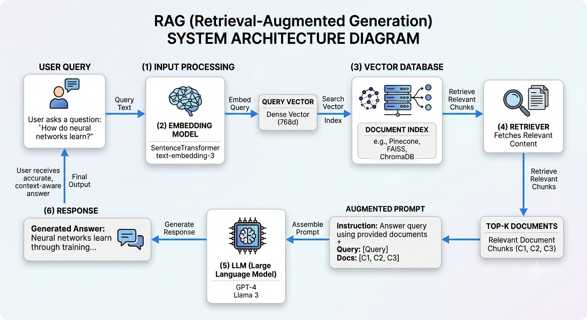

# Retrieval-Augmented Generation (RAG) with LangChain, LangGraph & LangSmith

<p align="center">
  
  
  
  
</p>

<p align="center">
  
  
  
  
  
</p>

<p align="center">
  <b>A practical, hands-on implementation of Retrieval-Augmented Generation (RAG) using LangChain, LangGraph and LangSmith.</b>
</p>

---

## Overview

This repository is a hands-on learning and implementation project focused on understanding and building Retrieval-Augmented Generation (RAG) systems using modern Generative AI frameworks.

The project explores the complete RAG lifecycle, starting from document ingestion and parsing to text splitting, embedding generation, vector storage, retrieval and LLM-powered response generation.

It also introduces LangGraph for orchestrating stateful AI workflows and LangSmith for tracing, monitoring, debugging and evaluating LLM applications.

**The objective is to develop a strong understanding of RAG architecture and progressively build practical, scalable and production-oriented AI applications.**

## Technology Stack

| Technology | Purpose |
|---|---|
| Python | Core programming language |
| LangChain | LLM application development |
| LangGraph | Stateful workflow orchestration |
| LangSmith | LLM tracing, monitoring and evaluation |
| ChromaDB | Vector database |
| FAISS | Vector similarity search |
| Sentence Transformers | Text embedding generation |
| PyMuPDF | PDF document extraction |
| OpenAI / Groq | LLM integration |
| UV | Dependency and environment management |

## RAG Architecture

<p align="center">
  
</p>

### Understanding the RAG Pipeline

The RAG architecture consists of two major phases:

**1. Indexing Pipeline**

- Document ingestion
- Document parsing and extraction
- Text cleaning and preprocessing
- Text splitting and chunking
- Embedding generation
- Vector database storage

**2. Retrieval and Generation Pipeline**

- User query
- Query embedding
- Similarity search
- Relevant document retrieval
- Context construction
- LLM response generation
- Context-grounded answer

## Repository Structure

```text
RAG_Using_LangChain_LangGraph_LangSmith/
│
├── DataIngestion_and_Parsing/
│   └── Document ingestion and parsing implementations
│
├── RAG_Architecture.png
│
├── main.py
├── pyproject.toml
├── requirements.txt
├── uv.lock
├── .python-version
├── .gitignore
├── LICENSE
└── README.md
```

Additional modules and implementations will be progressively organized as the project develops.

## Learning Modules

### Module 01: Data Ingestion and Document Parsing

Understand how to load different document formats and extract meaningful content.

Topics:
- Document loaders in LangChain
- PDF document loading
- PyMuPDFLoader
- PyPDFLoader
- UnstructuredPDFLoader
- Text file loading
- Document objects and metadata
- Document parsing and extraction

### Module 02: Text Splitting and Chunking

Understand how to transform large documents into smaller, meaningful text segments.

Topics:
- CharacterTextSplitter
- RecursiveCharacterTextSplitter
- TokenTextSplitter
- Chunk size and chunk overlap
- Metadata preservation
- Semantic chunking concepts

### Module 03: Embeddings

Understand how textual information is converted into numerical vector representations.

Topics:
- Understanding embeddings
- Word and sentence embeddings
- OpenAI embeddings
- Hugging Face embeddings
- Sentence Transformers
- Cosine similarity
- Semantic similarity

### Module 04: Vector Databases

Learn how to store, index and retrieve vector representations.

Topics:
- Vector databases fundamentals
- ChromaDB
- FAISS
- Similarity search
- Metadata filtering
- Vector indexing and retrieval

### Module 05: Retrieval Strategies

Understand how to retrieve relevant information from external knowledge sources.

Topics:
- Similarity search
- MMR retrieval
- Top-K retrieval
- Metadata-based retrieval
- Retriever configuration
- Context construction
- Retrieval optimization

### Module 06: RAG Implementation with LangChain

Build an end-to-end RAG application.

Topics:
- Prompt templates
- Document chains
- Retrieval chains
- Context injection
- LLM integration
- Grounded response generation
- Hallucination reduction

### Module 07: Advanced RAG

Explore techniques to improve retrieval quality and response accuracy.

Topics:
- Query transformation
- Query rewriting
- Multi-query retrieval
- Contextual compression
- Hybrid search
- Re-ranking
- Parent document retrieval
- RAG evaluation

### Module 08: LangGraph for RAG Workflows

Understand how to build stateful and controllable RAG workflows.

Topics:
- LangGraph fundamentals
- State management
- Nodes and edges
- Conditional edges
- Workflow orchestration
- Agentic RAG
- Corrective RAG (CRAG)
- Self-RAG concepts

### Module 09: LangSmith

Learn how to monitor, trace and evaluate LLM applications.

Topics:
- LangSmith introduction
- Tracing and observability
- Debugging LLM applications
- Run inspection
- Dataset creation
- Evaluation
- Performance monitoring

## Installation and Setup

### Prerequisites

- Python 3.12 or higher
- Git
- Visual Studio Code or another Python IDE
- UV package manager
- LLM provider API credentials when using hosted models

### Step 1: Clone the Repository

```bash
git clone https://github.com/chandanc5525/RAG_Using_LangChain_LangGraph_LangSmith.git

cd RAG_Using_LangChain_LangGraph_LangSmith
```

### Step 2: Install UV

```bash
pip install uv
```

### Step 3: Create Virtual Environment

```bash
uv venv
```

### Step 4: Activate Virtual Environment

**Windows:**

```bash
.venv\Scripts\activate
```

**Linux / macOS:**

```bash
source .venv/bin/activate
```

### Step 5: Install Dependencies

```bash
uv sync
```

Alternatively, install dependencies from requirements.txt:

```bash
uv pip install -r requirements.txt
```

### Step 6: Configure Environment Variables

Create a `.env` file in the project root.

```env
OPENAI_API_KEY=your_openai_api_key
GROQ_API_KEY=your_groq_api_key
LANGSMITH_API_KEY=your_langsmith_api_key

LANGSMITH_TRACING=true
LANGSMITH_PROJECT=RAG_Using_LangChain_LangGraph_LangSmith
```

Add your actual credentials only when using the corresponding services.

**Important:** Never commit API keys or sensitive credentials to GitHub.

## Running the Project

Execute the Python application:

```bash
uv run main.py
```

For individual learning modules, navigate to their respective directories and execute the relevant Python scripts or notebooks.

## Key Learning Outcomes

By completing this repository, learners should be able to:

- Understand the complete RAG architecture.
- Load and parse different document formats.
- Implement effective document chunking strategies.
- Generate and work with vector embeddings.
- Build semantic search applications.
- Integrate vector databases with LLMs.
- Develop end-to-end RAG applications using LangChain.
- Build stateful AI workflows using LangGraph.
- Trace, debug and evaluate LLM applications using LangSmith.
- Understand advanced and agentic RAG architectures.

## References and Documentation

| Resource | Documentation |
|---|---|
| LangChain | https://docs.langchain.com/ |
| LangGraph | https://docs.langchain.com/oss/python/langgraph/overview |
| LangSmith | https://docs.langchain.com/langsmith/home |
| ChromaDB | https://docs.trychroma.com/ |
| FAISS | https://github.com/facebookresearch/faiss |
| Hugging Face | https://huggingface.co/docs |
| PyMuPDF | https://pymupdf.readthedocs.io/ |
| UV | https://docs.astral.sh/uv/ |

## Author

**Chandan Chaudhari**

AI Engineer | Generative AI | Agentic AI | Data Science

GitHub: https://github.com/chandanc5525

---

<p align="center">
  <b>Learn. Build. Experiment. Implement.</b>
  <br/>
  Building practical AI engineering skills through hands-on implementation.
</p>

<p align="center">
  If you find this repository useful, consider giving it a ⭐ on GitHub.
</p>
